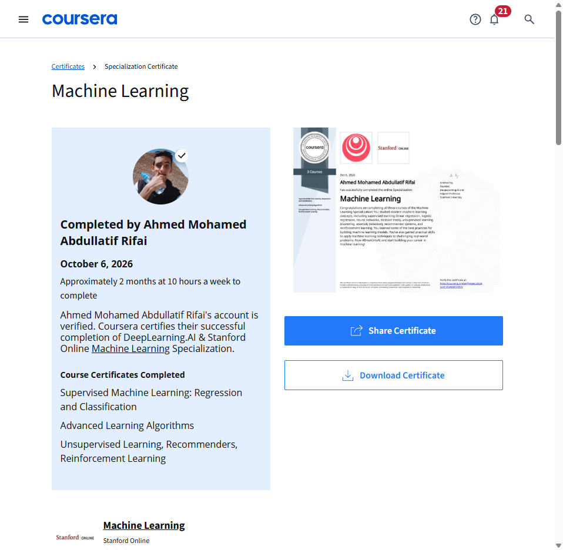
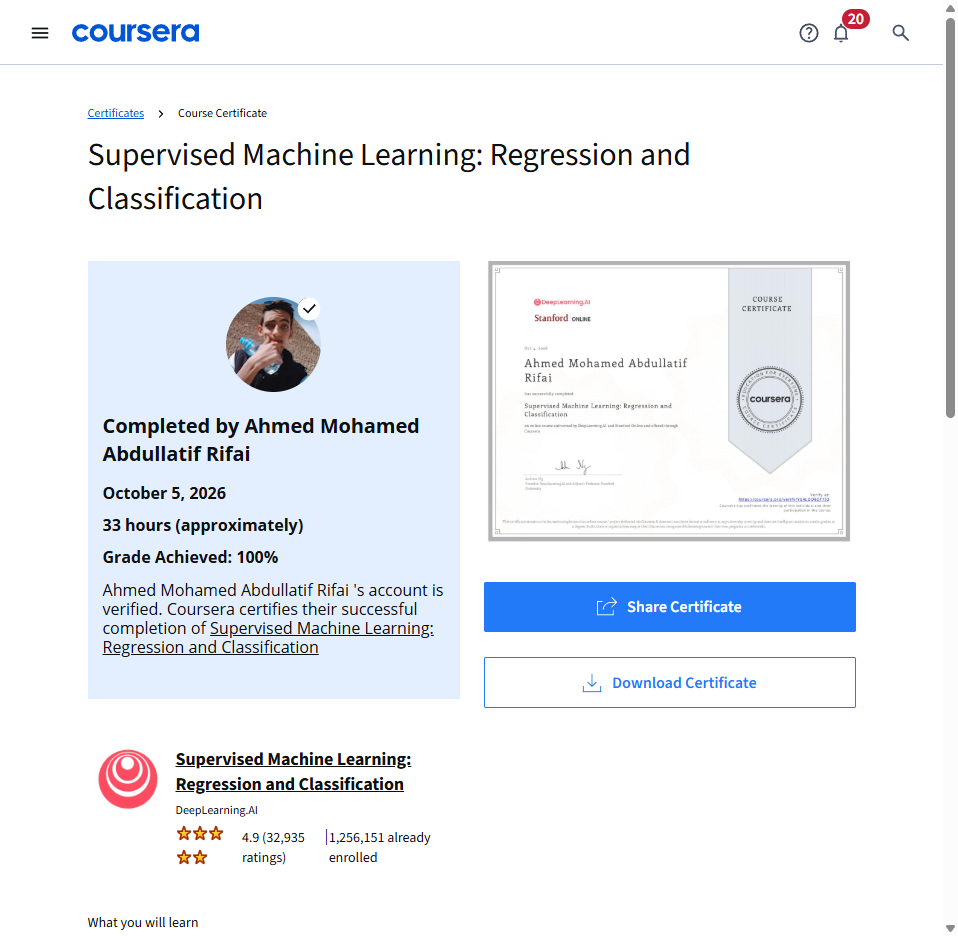
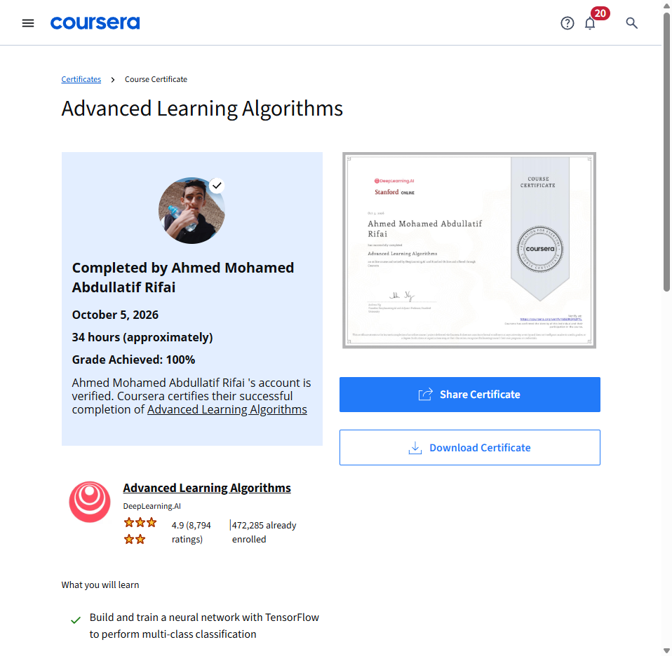
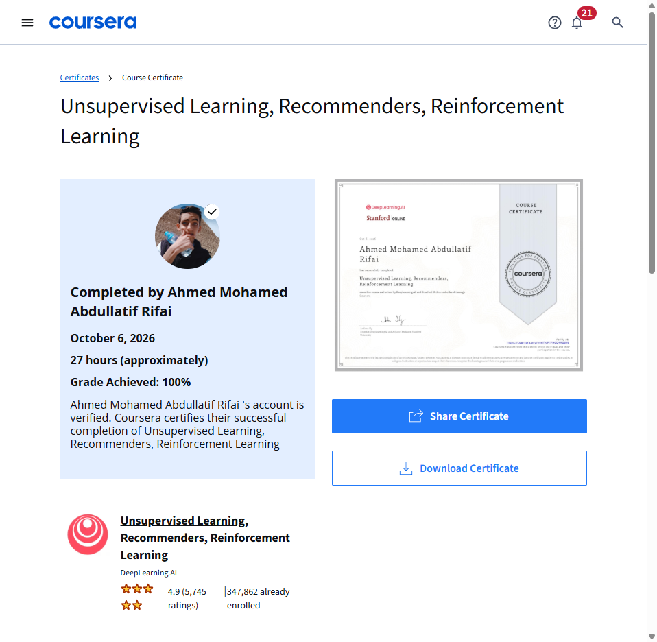

# 🧠 Machine Learning Specialization

[](https://www.deeplearning.ai)
[](https://online.stanford.edu)
[](https://python.org)
[](https://numpy.org)
[](https://tensorflow.org)
[](https://opensource.org/licenses/MIT)

Complete coursework, NumPy/TensorFlow/Jupyter implementations, vector math, and foundational algorithms for the **Machine Learning Specialization** taught by **Andrew Ng** (DeepLearning.AI & Stanford Online) on Coursera.

- **Learner:** Eng. Ahmed Mohamed Abdullatif Rifai  
- **Sponsor:** Kiron Open Higher Education Coursera License  
- **Completion Date:** October 6, 2026 (100.00% Across All Courses & Assessments)  
- **Specialization Credential ID:** [CVSVNIM5HXSN](https://www.coursera.org/account/accomplishments/specialization/CVSVNIM5HXSN)  

---

## 🏆 Curriculum & Credential Tracker

| # | Course Title | Status | Grade | Certificate / Verification |
| :-: | :--- | :---: | :---: | :---: |
| 1 | **[Supervised Machine Learning: Regression and Classification](01-Supervised-Machine-Learning-Regression-and-Classification/)** | ✅ **Completed** | **100.00%** | [YG4LQQ8DT7IQ](https://www.coursera.org/account/accomplishments/verify/YG4LQQ8DT7IQ) |
| 2 | **[Advanced Learning Algorithms](02-Advanced-Learning-Algorithms/)** | ✅ **Completed** | **100.00%** | [J65E9KQ92PYL](https://www.coursera.org/account/accomplishments/verify/J65E9KQ92PYL) |
| 3 | **[Unsupervised Learning, Recommenders, Reinforcement Learning](03-Unsupervised-Learning-Recommenders-Reinforcement-Learning/)** | ✅ **Completed** | **100.00%** | [P1FH0Q4RG5X6](https://www.coursera.org/account/accomplishments/verify/P1FH0Q4RG5X6) |
| 🎓 | **Machine Learning Specialization Master Credential** | 🏆 **Certified** | **100.00%** | [CVSVNIM5HXSN](https://www.coursera.org/account/accomplishments/specialization/CVSVNIM5HXSN) |

---

## 📂 Repository Structure

```text
Machine-Learning-Specialization/
├── 01-Supervised-Machine-Learning-Regression-and-Classification/
│   └── README.md              # Mathematical derivations, NumPy implementations & Quiz summaries
├── 02-Advanced-Learning-Algorithms/
│   └── README.md              # Neural networks, activation mechanics, diagnostics & Decision trees
├── 03-Unsupervised-Learning-Recommenders-Reinforcement-Learning/
│   └── README.md              # K-Means, Anomaly detection, Recommender Systems, Reinforcement learning (DQN)
├── certificates/
│   ├── DeepLearning_Machine_Learning_Specialization_Certificate_CVSVNIM5HXSN.pdf
│   ├── DeepLearning_Machine_Learning_Specialization_Certificate_CVSVNIM5HXSN.png
│   ├── DeepLearning_ML_Course1_Supervised_Machine_Learning_YG4LQQ8DT7IQ.pdf
│   ├── DeepLearning_ML_Course1_Supervised_Machine_Learning_YG4LQQ8DT7IQ.png
│   ├── DeepLearning_ML_Course1_grades_100pct.png
│   ├── DeepLearning_ML_Course2_Advanced_Learning_Algorithms_J65E9KQ92PYL.pdf
│   ├── DeepLearning_ML_Course2_Advanced_Learning_Algorithms_J65E9KQ92PYL.png
│   ├── DeepLearning_ML_Course2_grades_100pct.png
│   ├── DeepLearning_ML_Course3_Unsupervised_Learning_Recommenders_Reinforcement_Learning_P1FH0Q4RG5X6.pdf
│   ├── DeepLearning_ML_Course3_Unsupervised_Learning_Recommenders_Reinforcement_Learning_P1FH0Q4RG5X6.png
│   └── DeepLearning_ML_Course3_grades_100pct.png
└── README.md
```

---

## 📜 Verified Certificates & Specialization Credential

### 🎓 Specialization Master Credential: Machine Learning
- **Institution:** DeepLearning.AI & Stanford Online
- **Instructor:** Andrew Ng
- **Verification URL:** [https://www.coursera.org/account/accomplishments/specialization/CVSVNIM5HXSN](https://www.coursera.org/account/accomplishments/specialization/CVSVNIM5HXSN)
- **Vector PDF:** [`certificates/DeepLearning_Machine_Learning_Specialization_Certificate_CVSVNIM5HXSN.pdf`](certificates/DeepLearning_Machine_Learning_Specialization_Certificate_CVSVNIM5HXSN.pdf)

<p align="center">
  
</p>

---

### Course 1: Supervised Machine Learning: Regression and Classification
- **Grade:** 100.00%
- **Verification URL:** [https://www.coursera.org/account/accomplishments/verify/YG4LQQ8DT7IQ](https://www.coursera.org/account/accomplishments/verify/YG4LQQ8DT7IQ)
- **Vector PDF:** [`certificates/DeepLearning_ML_Course1_Supervised_Machine_Learning_YG4LQQ8DT7IQ.pdf`](certificates/DeepLearning_ML_Course1_Supervised_Machine_Learning_YG4LQQ8DT7IQ.pdf)

<p align="center">
  
</p>

---

### Course 2: Advanced Learning Algorithms
- **Grade:** 100.00%
- **Verification URL:** [https://www.coursera.org/account/accomplishments/verify/J65E9KQ92PYL](https://www.coursera.org/account/accomplishments/verify/J65E9KQ92PYL)
- **Vector PDF:** [`certificates/DeepLearning_ML_Course2_Advanced_Learning_Algorithms_J65E9KQ92PYL.pdf`](certificates/DeepLearning_ML_Course2_Advanced_Learning_Algorithms_J65E9KQ92PYL.pdf)

<p align="center">
  
</p>

---

### Course 3: Unsupervised Learning, Recommenders, Reinforcement Learning
- **Grade:** 100.00%
- **Verification URL:** [https://www.coursera.org/account/accomplishments/verify/P1FH0Q4RG5X6](https://www.coursera.org/account/accomplishments/verify/P1FH0Q4RG5X6)
- **Vector PDF:** [`certificates/DeepLearning_ML_Course3_Unsupervised_Learning_Recommenders_Reinforcement_Learning_P1FH0Q4RG5X6.pdf`](certificates/DeepLearning_ML_Course3_Unsupervised_Learning_Recommenders_Reinforcement_Learning_P1FH0Q4RG5X6.pdf)

<p align="center">
  
</p>
