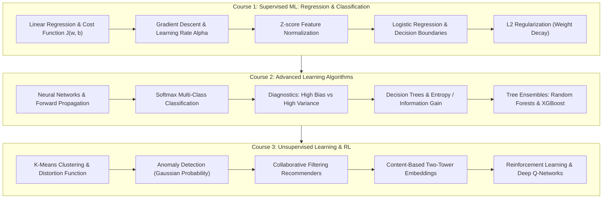

# 🧠 Machine Learning Specialization Study Hub & Code Repository

<div align="center">

### **🏆 Official 3-Course Specialization — 100% Grade Perfection**

[](https://www.coursera.org/account/accomplishments/specialization/CVSVNIM5HXSN)
[](https://www.coursera.org/account/accomplishments/specialization/CVSVNIM5HXSN)
[](https://python.org)
[](https://numpy.org)
[](https://tensorflow.org)

**Learner:** Eng. Ahmed Mohamed Abdullatif Rifai  
**Instructors:** Andrew Ng, Eddy Shyu, Aarti Bagul, Geoff Ladwig (DeepLearning.AI & Stanford Online)  
**License:** Kiron Open Higher Education Coursera License  
**Comprehensive Study Guide:** [📖 Read the Complete Machine Learning Study Guide](STUDY_GUIDE.md)

</div>

---

## 📌 Repository Overview

This repository serves as a mathematical study hub, algorithmic reference, and code repository for the **Machine Learning Specialization** created by Andrew Ng. It documents fundamental and modern machine learning algorithms implemented from mathematical first principles in NumPy, progressing into TensorFlow deep neural networks, decision tree ensembles (Random Forests, XGBoost), unsupervised algorithms, collaborative filtering recommenders, and Deep Q-Learning (DQN).

> [!NOTE]
> All binary credential certificates and verification proofs are officially archived in Google Drive and verified via official Coursera credential IDs. This repository focuses strictly on high-yield technical artifacts: structured coursework, reusable Python modules in `src/`, and mathematical study guides.

---

## 🏗️ Specialization Roadmap



---

## 📚 Curriculum & Course Breakdown

| # | Course Title | Score | Focus Areas | Official Verification |
|:---:|:---|:---:|:---|:---:|
| **01** | Supervised Machine Learning: Regression & Classification | **100%** | Cost functions, Vectorized Gradient Descent, Logistic Regression, L2 Regularization | [YG4LQQ8DT7IQ](https://www.coursera.org/account/accomplishments/verify/YG4LQQ8DT7IQ) |
| **02** | Advanced Learning Algorithms | **100%** | Neural networks, ReLU/Softmax, Bias/Variance diagnostics, Decision Trees, XGBoost | [J65E9KQ92PYL](https://www.coursera.org/account/accomplishments/verify/J65E9KQ92PYL) |
| **03** | Unsupervised Learning, Recommenders, Reinforcement Learning | **100%** | K-Means, Anomaly Detection, Matrix Factorization, Deep Q-Networks (DQN) | [P1FH0Q4RG5X6](https://www.coursera.org/account/accomplishments/verify/P1FH0Q4RG5X6) |
| 🎓 | **Full Machine Learning Specialization Credential** | **100%** | **Stanford / DeepLearning.AI Master Credential** | [CVSVNIM5HXSN](https://www.coursera.org/account/accomplishments/specialization/CVSVNIM5HXSN) |

---

## 📂 Repository Structure

```text
├── STUDY_GUIDE.md                     # Comprehensive theoretical & mathematical study guide
├── README.md                          # Repository overview & verification index
├── .gitignore                         # Excludes cache & certificate binaries
├── src/
│   └── ml_foundations/
│       ├── __init__.py                # Package initialization
│       ├── linear_models.py           # Vectorized Linear & Logistic Regression from scratch
│       └── collaborative_filtering.py # Matrix Factorization & Recommender Cost/Gradients
├── 01-Supervised-Machine-Learning.../ # Course 1 Labs & Mathematical Derivations
├── 02-Advanced-Learning-Algorithms/   # Course 2 Neural Networks & Decision Trees
└── 03-Unsupervised-Learning.../       # Course 3 K-Means, Recommenders & Reinforcement Learning
```

---

## 🚀 Quickstart & Algorithm Toolkit

### Installation
```bash
git clone https://github.com/Eng-Ahmed-Rifai/Machine-Learning-Specialization.git
cd Machine-Learning-Specialization
python -m venv .venv
source .venv/bin/activate  # On Windows: .venv\Scripts\activate
pip install numpy matplotlib tensorflow
```

### 1. Vectorized Linear Regression
```python
import numpy as np
from ml_foundations.linear_models import compute_linear_cost, compute_linear_gradient

X = np.array([[1.0, 2.0], [2.0, 3.0], [3.0, 4.0]])
y = np.array([2.5, 4.5, 6.5])
w = np.zeros(2)
b = 0.0

cost = compute_linear_cost(X, y, w, b, lambda_=0.1)
dj_dw, dj_db = compute_linear_gradient(X, y, w, b, lambda_=0.1)
print(f"Cost: {cost:.4f}, Grad w: {dj_dw}, Grad b: {dj_db:.4f}")
```

### 2. Collaborative Filtering Cost & Gradients
```python
import numpy as np
from ml_foundations.collaborative_filtering import cofi_cost_func

X = np.random.randn(10, 4)  # 10 items, 4 features
W = np.random.randn(5, 4)   # 5 users, 4 features
b = np.zeros((1, 5))
Y = np.random.randint(1, 6, size=(10, 5)).astype(float)
R = (Y > 0).astype(float)

cost, X_grad, W_grad, b_grad = cofi_cost_func(X, W, b, Y, R, lambda_=1.0)
print(f"Recommender Cost: {cost:.4f}")
```

---

## 👤 Author
**Eng. Ahmed Rifai**  
*AI & Computer Vision Engineer*  
GitHub: [@Eng-Ahmed-Rifai](https://github.com/Eng-Ahmed-Rifai)
